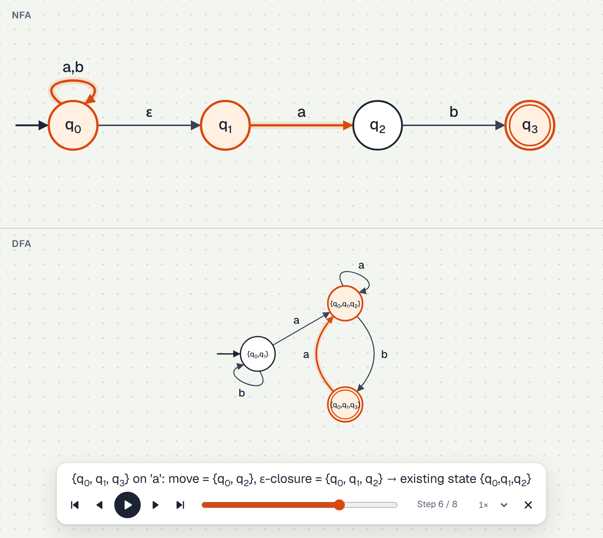
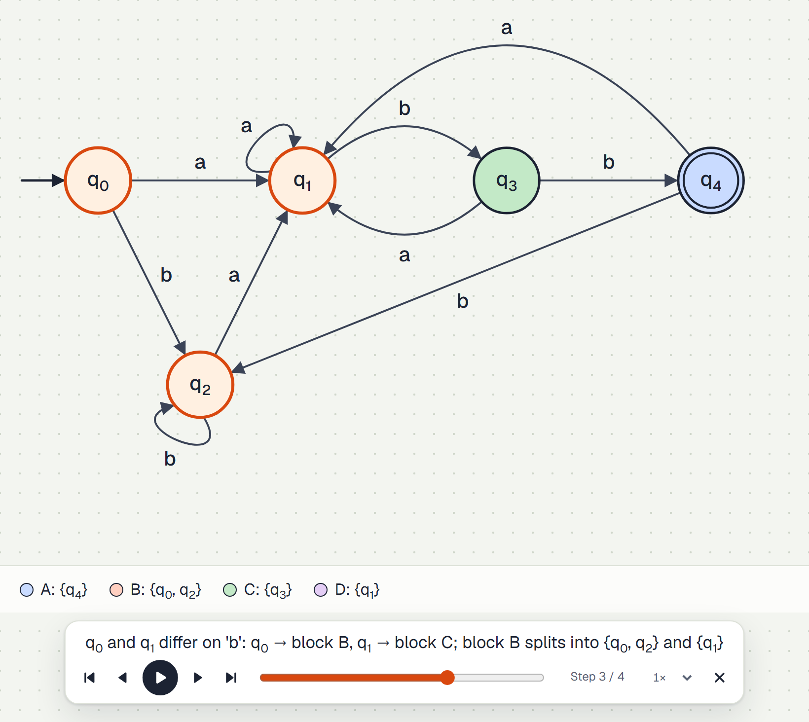

<p align="center">
  <picture>
    <source media="(prefers-color-scheme: dark)" srcset="docs/brand/lockup-dark.png">
    
  </picture>
</p>

<h3 align="center">Watch automata come to life.</h3>

<p align="center">
  Draw a DFA or an NFA, type a word, and watch it run, one symbol at a time.<br>
  Then convert it and minimize it, step by step, with every step explained.
</p>

<p align="center">
  <a href="https://tomerti.github.io/automotion/"><b>Open AutoMotion</b></a>
  &nbsp;&nbsp;|&nbsp;&nbsp;
  <a href="#get-started">Get started</a>
  &nbsp;&nbsp;|&nbsp;&nbsp;
  <a href="#development">Development</a>
</p>

<p align="center">
  <a href="https://github.com/Tomerti/automotion/actions/workflows/ci.yml"></a>
  <a href="LICENSE"></a>
</p>


AutoMotion is a free, in-browser playground for finite automata, made for students learning
automata theory and for the people who teach it. There is nothing to install and no account:
open the page and start drawing. Your automata are saved in your browser.

## Get started

1. **Open [AutoMotion](https://tomerti.github.io/automotion/).** On your first visit it offers a
   short tutorial: you build a DFA for "an even number of zeros", run a few words on it, then
   change it to accept every word.
2. **Draw.** Double-click the canvas to add a state. Hold **Shift** and drag from one state to
   another to add a transition, then type its symbols. Select a state and press **S** to make it
   the start state, **A** to make it accepting.
3. **Run a word.** Type it into **Test a word** and press **Enter**.

Press **?** at any time for every control.

## What you can do

### Learn by doing


- The tutorial shows what you are building (a picture of the finished automaton and example
  words), then one short step at a time.
- It checks your automaton as you go, points at what to use next, and steps back if you undo
  something it needs.
- Restart it whenever you like from the controls guide (**?**).

### Build and arrange


- **DFAs and NFAs**, with ε-transitions and several start states. Switch between them with the
  DFA / NFA switch; adding an ε-transition makes a DFA an NFA.
- **Real notation:** `q_1` and `q_{12}` show as subscripts, `\eps` types ε and `\emptyset`
  types ∅.
- **Mistakes are pointed out.** The issues chip lists what is wrong (no start state, two
  arrows on one symbol in a DFA, a missing transition, unreachable states) and rings those
  states on the canvas. A disabled button always says why.
- **Neat diagrams.** States snap into line and to equal gaps as you drag them. Bend arrows,
  turn self-loops and start arrows, and move an arrow's symbols to its other side. **Tidy**
  lays the whole automaton out the way you would draw it by hand.
- **Copy and paste** states with their arrows, within an automaton or into another one, to
  build repeating chains quickly. Undo and redo work per automaton.

### Run a word

- The run plays at once on a tape with a read head, lighting up the active states and the
  arrow just taken (see the screenshot at the top).
- Pause, step back and forth, scrub to any step and change the speed. NFA runs show each
  ε-closure as its own step and mark the branches that die.
- The run ends in **Accepted** or **Rejected**, and says why.

### Convert an NFA to a DFA



- **Convert to DFA** walks through the subset construction with the NFA and the growing DFA
  side by side: one move and ε-closure per step, each one explained in words.
- Save the result as a new automaton, or choose **Save and minimize** to go straight on to
  minimizing it.

### Minimize a DFA



- **Minimize** walks through partition refinement: states are tinted by block, and each step
  says which states differ, on which symbol, and how the block splits.
- It says so when a DFA is already minimal, and adds the dead state an incomplete DFA needs.
- Pan and zoom in both walkthroughs like on the canvas, so bigger automata stay readable.

### Save, share and export

- **History.** Everything autosaves. The sidebar lists your automata with a thumbnail, most
  recently edited first; rename, duplicate, export or delete one from its **⋯** menu.
- **Share links.** **Copy link** puts an automaton in a link. Whoever opens it gets their own
  copy to run and edit.
- **Pictures.** Copy the diagram as an image (**Ctrl+C** with nothing selected) and paste it
  into a document or a chat, or download it as SVG or PNG. It is always the whole automaton,
  however the canvas is zoomed.
- **LaTeX, both ways.** Export an automaton as a TikZ picture (the `automata` library), laid
  out as on the canvas, or every automaton into one `.tex` document. Import works too: open a
  `.tex` file, or copy a `tikzpicture` from Overleaf or your lecture notes and press **Ctrl+V**
  in the app. Hand-written TikZ automata are read as well.
- **Files.** Import and export JSON, one automaton or all of them. Dropping a `.json` or `.tex`
  file on the page imports it.

## Controls

| To                           | Do this                                                  |
| ---------------------------- | -------------------------------------------------------- |
| Add a state                  | Double-click the empty canvas                            |
| Add a transition             | **Shift** + drag from state to state (onto itself: loop) |
| Rename a state, edit symbols | Double-click the state or the arrow                      |
| Toggle start / accepting     | Select a state, press **S** / **A**                      |
| Select several states        | **Ctrl** + drag a box, or **Ctrl** + click               |
| Move, bend, turn             | Drag a state, an arrow or a loop (**Alt**: no snapping)  |
| Pan / zoom                   | Drag the empty canvas / scroll                           |
| Copy / paste                 | **Ctrl+C** / **Ctrl+V**                                  |
| Undo / redo                  | **Ctrl+Z** / **Ctrl+Y**                                  |
| Run a word                   | Type it in **Test a word**, press **Enter**              |
| Play / step / leave a run    | **Space** / **←** **→** / **Esc**                        |
| All controls                 | **?**                                                    |

## Good to know

- **Your work stays in your browser.** AutoMotion has no server and no account. Clearing your
  browser's site data deletes your automata, so use **Export all** to keep a copy. A share
  link carries its automaton inside the link itself.
- **Light and dark themes.** AutoMotion follows your system theme, or pick one from the theme
  menu in the top bar.
- **Phones** can open share links and run words; building automata needs a mouse and a
  keyboard.

## Development

AutoMotion is a static site: TypeScript, React, Vite, Zustand and elkjs, with a custom SVG
renderer.

```sh
npm install
npm run dev        # dev server at http://localhost:5173/automotion/
npm test           # unit and component tests (Vitest)
npm run e2e        # end-to-end tests (Playwright; first run: npx playwright install chromium)
npm run build      # type-check and build into dist/
```

- **Where things live:** `src/core/` holds the automata logic (pure TypeScript: runs, subset
  construction, minimization, validation), `src/layout/` the Tidy layout, `src/store/` the app
  state, `src/persistence/` autosave, files, share links and LaTeX import, and `src/ui/` the
  React interface.
- **CI** runs type-checking, lint, unit and end-to-end tests on every push and pull request,
  compiles the exported LaTeX with pdflatex, and deploys `master` to GitHub Pages once all of
  it passes.
- **Pictures in this README** are regenerated by `node docs/screenshots/take.mjs` (see the
  script for the steps); the logo files are in [docs/brand](docs/brand).
- **What's next** is tracked in [PROGRESS.md](PROGRESS.md). Found a bug or have an idea?
  [Open an issue](https://github.com/Tomerti/automotion/issues).

## License

[MIT](LICENSE)
