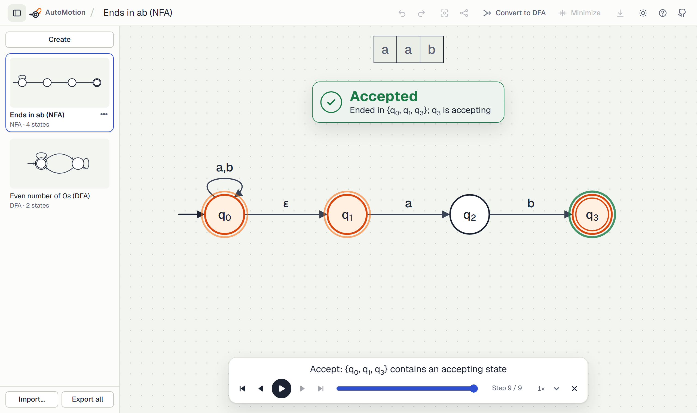
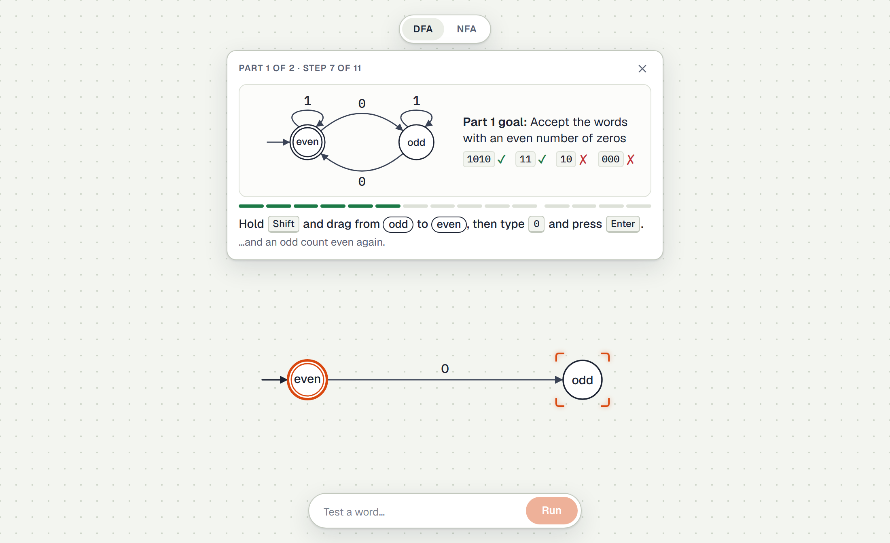

<p align="center">
  <picture>
    <source media="(prefers-color-scheme: dark)" srcset="docs/brand/lockup-dark.png">
    
  </picture>
</p>

<h3 align="center">Watch automata come to life.</h3>

<p align="center">
  Draw a DFA or an NFA, type a word, and watch it run, one symbol at a time.<br>
  Convert NFAs to DFAs and minimize them, with every step explained.
</p>

<p align="center">
  <a href="https://tomerti.github.io/automotion/"><b>Open AutoMotion</b></a>
  &nbsp;&nbsp;|&nbsp;&nbsp;
  <a href="#get-started">Get started</a>
  &nbsp;&nbsp;|&nbsp;&nbsp;
  <a href="#what-you-can-do">Features</a>
  &nbsp;&nbsp;|&nbsp;&nbsp;
  <a href="#development">Development</a>
</p>

<p align="center">
  <a href="https://github.com/Tomerti/automotion/actions/workflows/ci.yml"></a>
  <a href="LICENSE"></a>
</p>



AutoMotion is a free, in-browser playground for finite automata, made for students learning
automata theory and for the people who teach it. There is nothing to install and no account:
open the page and start drawing. Your automata are saved in your browser.

## Get started

1. **Open [AutoMotion](https://tomerti.github.io/automotion/).** On your first visit it offers a
   short tutorial: build a DFA for "an even number of zeros", run a few words on it, then change
   it to accept every word.
2. **Draw.** Double-click the canvas to add a state. Hold **Shift** and drag from one state to
   another to add a transition, then type its symbols. Select a state and press **S** to make it
   the start state, **A** to make it accepting.
3. **Run a word.** Type it into **Test a word** and press **Enter**.

Press **?** at any time to see every control.

## What you can do

### Learn by doing



- **See the goal first.** Each part of the tutorial shows the finished automaton and example
  words, then walks you there one short step at a time.
- **Guided as you go.** It checks your automaton live, points at what to use next, and steps
  back if you undo something it needs.
- **Take it again** whenever you like from the controls guide (**?**).

### Build and arrange


- **DFAs and NFAs.** NFAs can have ε-transitions and several start states. Switch kinds with the
  DFA / NFA switch; adding an ε-transition turns a DFA into an NFA.
- **Real notation.** `q_1` and `q_{12}` show as subscripts. Type `\eps` for ε in symbols and
  words, and `\emptyset` for ∅ in a state name.
- **Mistakes are pointed out.** The issues chip lists what is wrong: no start state, two arrows
  on one symbol in a DFA, a missing transition, unreachable states. Open it to see them ringed.
- **Blocked actions explain themselves.** Run, Convert to DFA and Minimize say why when you
  can't use them yet.
- **Neat diagrams.** States snap into line and to equal gaps as you drag. Bend arrows, turn loops
  and start arrows, and flip an arrow's symbols to its other side.
- **Tidy** lays out the whole automaton the way you would draw it by hand.
- **Copy and paste** states with their arrows, within an automaton or into another one. Undo and
  redo work per automaton.

### Run a word

- **Watch it read.** The run plays at once on a tape with a read head, lighting up the active
  states and the arrow just taken (the screenshot at the top).
- **Go at your own pace.** Pause, step back and forth, scrub to any step and change the speed.
- **NFAs in full.** Each ε-closure is its own step, and branches that die are marked.
- **A clear verdict.** The run ends in **Accepted** or **Rejected**, and says why.

### Convert an NFA to a DFA


- **Side by side.** The NFA sits above and the DFA grows below as **Convert to DFA** walks
  through the subset construction.
- **Every step explained.** One move and ε-closure per step, each one spelled out in words.
- **Keep the result.** Save it as a new automaton, or choose **Save and minimize** to go straight
  on to minimizing it.

### Minimize a DFA


- **Watch the blocks split.** Each state is tinted by its block as **Minimize** walks through
  partition refinement.
- **Every step explained.** Each step says which states differ, on which symbol, and how the
  block splits.
- **Any DFA.** It says so when a DFA is already minimal, and adds the dead state an incomplete
  DFA needs.
- **Room to look.** Both walkthroughs pan and zoom like the canvas, so bigger automata stay
  readable.

### Save, share and export

- **History.** Everything autosaves. The sidebar lists your automata, newest edit first; rename,
  duplicate, export or delete one from its **⋯** menu.
- **Share links.** Put an automaton in a link with **Copy link**. Whoever opens it gets their own
  copy to run and edit.
- **Pictures.** Copy the diagram as an image (**Ctrl+C** with nothing selected), or download it as
  SVG or PNG. It is always the whole automaton, however the canvas is zoomed.
- **LaTeX export.** Download an automaton as a TikZ picture (the `automata` library), laid out as
  on the canvas, or every automaton into one `.tex` document.
- **LaTeX import.** Open a `.tex` file, or copy a `tikzpicture` from Overleaf or your lecture notes
  and press **Ctrl+V** (or use **Import → Paste LaTeX…**). Hand-written TikZ works too.
- **JSON files.** Import and export one automaton or all of them. Dropping a `.json` or `.tex`
  file on the page imports it.

## Controls

| To                           | Do this                                                       |
| ---------------------------- | ------------------------------------------------------------- |
| Add a state                  | Double-click the empty canvas                                 |
| Add a transition             | **Shift** + drag from state to state (onto itself for a loop) |
| Rename a state, edit symbols | Double-click the state or the arrow                           |
| Toggle start / accepting     | Select a state, press **S** / **A**                           |
| Select several states        | **Ctrl** + drag a box, or **Ctrl** + click                    |
| Move, bend, turn             | Drag a state, an arrow, a loop or the start arrow             |
| Place freely                 | Hold **Alt** while dragging (no snapping)                     |
| Pan / zoom                   | Drag the empty canvas / scroll                                |
| Copy / paste                 | **Ctrl+C** / **Ctrl+V**                                       |
| Undo / redo                  | **Ctrl+Z** / **Ctrl+Y**                                       |
| Run a word                   | Type it in **Test a word**, press **Enter**                   |
| Play / step / leave a run    | **Space** / **←** **→** / **Esc**                             |
| See every control            | **?**                                                         |

On a Mac, **Cmd** works wherever **Ctrl** does.

## Good to know

- **Your work stays in your browser.** There is no server and no account. Clearing your
  browser's site data deletes your automata, so use **Export all** to keep a copy.
- **Share links are self-contained.** The automaton travels inside the link itself.
- **Light and dark themes.** AutoMotion follows your system theme, or pick one from the theme
  menu in the top bar.
- **Phones** can open share links and run words; building automata needs a mouse and keyboard.

## Development

AutoMotion is a static site: TypeScript, React, Vite, Zustand and elkjs, with a custom SVG
renderer.

```sh
npm install
npm run dev        # dev server at http://localhost:5173/automotion/
npm test           # unit and component tests (Vitest)
npm run e2e        # end-to-end tests (Playwright; first run: npx playwright install chromium)
npm run build      # type-check and build into dist/
```

| Folder             | What's in it                                                               |
| ------------------ | -------------------------------------------------------------------------- |
| `src/core/`        | The automata logic, pure TypeScript: runs, subset construction, minimizing |
| `src/layout/`      | Tidy, the automatic layout                                                 |
| `src/store/`       | App state, undo and redo                                                   |
| `src/persistence/` | Autosave, files, share links and LaTeX import                              |
| `src/ui/`          | The React interface                                                        |

- **CI** runs type-checking, lint, unit and end-to-end tests on every push and pull request,
  compiles the exported LaTeX with pdflatex, and deploys `master` to GitHub Pages when all pass.
- **Logo and screenshots** are in `docs/brand` and `docs/screenshots`;
  [docs/brand](docs/brand) explains how to regenerate both.
- **What's next** is tracked in [PROGRESS.md](PROGRESS.md). Found a bug or have an idea?
  [Open an issue](https://github.com/Tomerti/automotion/issues).

## License

[MIT](LICENSE)
