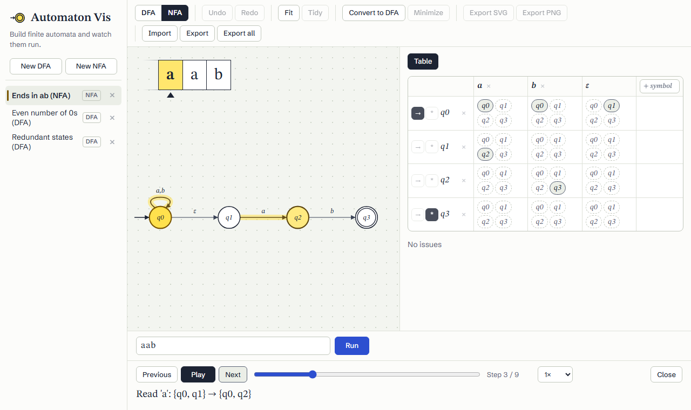

# Automaton Vis

Visualize finite automata (DFA, NFA): build them, draw them, and step through their run on a word.

**Live:** https://tomerti.github.io/automaton-vis/



## Features

- **Build automata**: create, edit and delete DFAs and NFAs: states, start state, accepting states, alphabet and transitions (including ε-transitions for NFAs), from the canvas or the transition table, with undo/redo.
- **Draw**: render each automaton as a state diagram and edit it directly on the canvas: double-click to add a state, drag from a state's ring to draw a transition, drag to reposition, auto-layout (Tidy) and fit to view.
- **Run a word**: enter an input word and step through the run, highlighting the active state(s) at each symbol, then show whether the word is accepted. Play, step back and forth, or scrub.
- **Algorithms**: step-by-step walkthroughs of NFA → DFA conversion (subset construction) and DFA minimization (partition refinement), with the result savable as a new automaton.
- **Manage**: keep several automata (autosaved in the browser), import and export them as JSON, and export a diagram as SVG or PNG.

## Development

```
npm install
npm run dev      # start the dev server
npm test         # unit tests (Vitest)
npm run e2e      # end-to-end smoke tests (Playwright, Chromium; builds and serves the app)
npm run build    # type-check and production build into dist/
```

The first `npm run e2e` needs a browser: `npx playwright install chromium`.

## Status

v1 is implemented and deployed to GitHub Pages on every push to `master`. See [PROGRESS.md](PROGRESS.md) for current and upcoming tasks.
