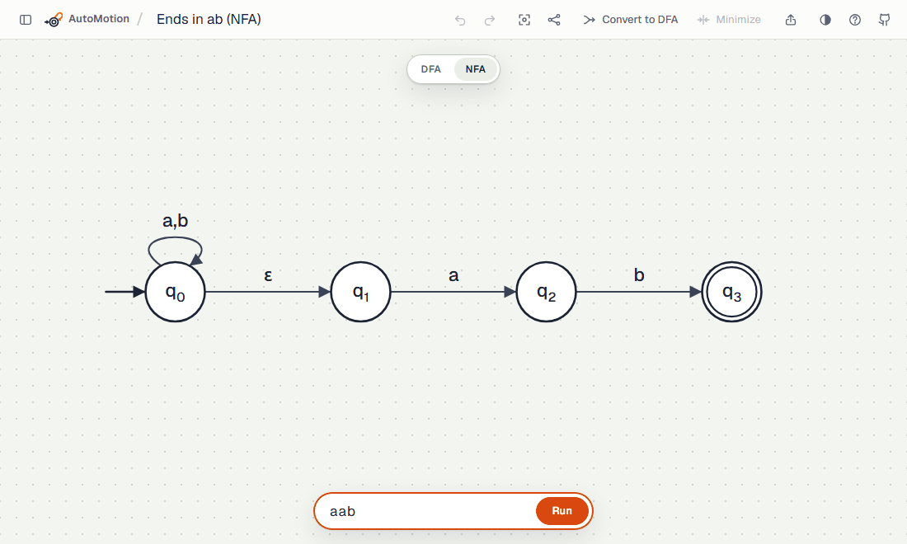

<p align="center">
  
  
</p>

<h3 align="center">Watch automata come to life.</h3>

<p align="center">
  Draw a DFA or an NFA, type a word, and watch it run, one symbol at a time.<br>
  Convert NFAs to DFAs, minimize them, and go to and from regexes, with every step explained.
</p>

<p align="center">
  <a href="https://tomerti.github.io/automotion/"><b>Open AutoMotion</b></a>
  &nbsp;&nbsp;|&nbsp;&nbsp;
  <a href="#get-started">Get started</a>
  &nbsp;&nbsp;|&nbsp;&nbsp;
  <a href="#what-you-can-do">Features</a>
  &nbsp;&nbsp;|&nbsp;&nbsp;
  <a href="#development">Development</a>
</p>

<p align="center">
  <a href="https://github.com/Tomerti/automotion/actions/workflows/ci.yml"></a>
  <a href="LICENSE"></a>
</p>



AutoMotion is a free, in-browser playground for finite automata, made for students learning
automata theory and for the people who teach it. There is nothing to install and no account:
open the page and start drawing. It follows your system's light or dark theme.

## Get started

1. **Open [AutoMotion](https://tomerti.github.io/automotion/).** On your first visit it offers a
   short tutorial: build a DFA for "an even number of zeros", run a few words on it, then change
   it to accept every word.
2. **Draw.** Double-click the canvas to add a state. Hold **Shift** and drag from one state to
   another to add a transition, then type its symbols. Select a state and press **S** to make it
   the start state, **A** to make it accepting.
3. **Run a word.** Type it into **Test a word** and press **Enter**.

**Try it without drawing:** open [an NFA for "ends in ab"][try-nfa] and run `aab`, or
[a DFA for "ends in abb"][try-dfa] and press **Minimize**.

Press **?** in the app to see every control.

[try-nfa]: https://tomerti.github.io/automotion/#a=bZBBTsMwEEWvEv0VSI4UO2TjXRd02QtUVTVpXbBI7DYeKqqKY3ENzoTsKCWGypvx-P3x_3PFwQ89MTTonX3v2XoHgbMZQqy0EuMDMUGvr3DUG2g8u30orCuoLR5Wy8UjBN6s20NjtVxAgLrjK7WGodcgCLTYCAQmNiGNsRE9VRDoqDVdvGzj7QNaVpXABVo21aeYSJmRciRVc4dUGalG8unezDoj65FsZjNHywNHy9HsRoB2O3Nk615Sq44tHsgFG_eWRStTusPg-ykp-6kKl771XZgt59dVVaaw_4UyF35_zVWyTMEnlbyp1N_vZiJVph1MInUT1bko-ovnBw
[try-dfa]: https://tomerti.github.io/automotion/#a=jZLRasMgFIZfpfxXG5iRJs3GvEvVvkQpQ1vbhSWaRTdWyt592ITNsLQUb0S_c36_gyfsbddIDwr54W1jfWUNCD5158KOZqS_kF6Crk8wstGgEGbnZpWZSaVmd3xV3oPgrTI7UPBVCQJZt69SaQ-6hgSBwobAeem1O_epAhrAWipdg-L9JQXBF-g8TQmOoPMi_SYDuByB8x7Miv8gG4HZ0PGpOIN5-gfyEZj34GIiWozARQ8WUXTv1fnghTJoyu1Wt74yh3AiwonvpHFVmG1snwStfWebYRTeDqru2Chbu352m9-nlAmbKGDjAhUVLOOE5eUEgtratjSHWoMm2UNePGZREz7RhF9OZXEqu8GLxV7sBi8eJ_AbEngiJgrE5QQRJ4hrk1M6_PrkOfoxsY64ohPWDw

## What you can do

### Learn by doing


- **See the goal first.** Each part of the tutorial shows the finished automaton and example
  words, then walks you there one short step at a time.
- **Guided as you go.** It checks your automaton live and points at what to use next.
- **Short lessons after the basics.** Five one-minute lessons, each on a ready-made automaton
  you can't break: **NFAs**, **ε-moves**, **Convert NFA → DFA**, **Minimize a DFA** and
  **Share and export**. They pause at the moment they explain, and finished ones get a ✓.
- **Find them again** whenever you like: press **?** and open the **Lessons** tab.

### Build and arrange

- **DFAs and NFAs.** NFAs can have ε-transitions and several start states. Labels like `q_1`
  show as subscripts; type `\eps` for ε (in symbols and words) and `\emptyset` for ∅ (in state
  names).
- **Mistakes are pointed out.** The issues chip lists what is wrong, from a missing start state
  to unreachable states, and Run, Convert to DFA and Minimize say why when they are blocked.
- **Neat diagrams.** States snap into line as you drag, arrows bend, and **Tidy** lays out the
  whole automaton the way you would draw it by hand.
- **Cut, copy and paste** states with their arrows, within an automaton or into another one.

### Run a word

- **Watch it read.** The run plays on a tape with a read head, lighting up the active states and
  the arrow just taken (the animation at the top).
- **Go at your own pace.** Pause, step back and forth, or scrub. NFA runs show each ε-closure as
  its own step and mark the branches that die.
- **A clear verdict.** The run ends in **Accepted** or **Rejected**, and says why.

### Convert and minimize, step by step

<p>
  
  
</p>

- **Convert to DFA** walks through the subset construction, with the NFA above and the growing
  DFA below: one move and ε-closure per step.
- **Minimize** walks through partition refinement, tinting each state by its block and saying
  which states differ and on which symbol.
- **Every step is explained** in words. Save the result as a new automaton, or go from a
  conversion straight to minimizing it.

### Regular expressions

- **From regex…** (in **Create**) creates the minimal DFA for the regex.
- **To regex** removes states one at a time until a simplified regex is left. Click a state while paused to
  choose which goes next.
- **The syntax:** `|` for or, `+` one or more, `*` any number, `\eps` for ε, `\emptyset` for ∅;
  write symbols side by side to join them and use `( )` to group.

### Save, share and export

- **History.** Everything autosaves. The sidebar lists your automata, newest edit first. Import
  and export them as JSON, one at a time or all at once.
- **Share links.** Put an automaton in a link with **Share link**. Whoever opens it gets their own
  copy, carried inside the link itself.
- **Pictures.** Copy the diagram as an image (**Ctrl+C** with nothing selected), or download it as
  SVG or PNG.
- **LaTeX, both ways.** Export TikZ (the `automata` library), laid out as on the canvas. Import a
  `.tex` file, or copy a `tikzpicture` from Overleaf and press **Ctrl+V**.

## Good to know

- **Your work stays in your browser.** There is no server and no account. Clearing your
  browser's site data deletes your automata, so use **Export all** to keep a copy.
- **Phones** can open share links and run words; building automata needs a mouse and keyboard.

## Development

AutoMotion is a static site: TypeScript, React, Vite, Zustand and elkjs, with a custom SVG
renderer.

```sh
npm install
npm run dev        # dev server at http://localhost:5173/automotion/
npm test           # unit and component tests (Vitest)
npm run e2e        # end-to-end tests (Playwright; first run: npx playwright install chromium)
npm run build      # type-check and build into dist/
```

| Folder             | What's in it                                                               |
| ------------------ | -------------------------------------------------------------------------- |
| `src/core/`        | The automata logic, pure TypeScript: runs, subset construction, minimizing |
| `src/layout/`      | Tidy, the automatic layout                                                 |
| `src/store/`       | App state, undo and redo                                                   |
| `src/persistence/` | Autosave, files, share links and LaTeX import                              |
| `src/ui/`          | The React interface                                                        |

- **CI** runs type-checking, lint, unit and end-to-end tests on every push and pull request,
  compiles the exported LaTeX with pdflatex, and deploys `master` to GitHub Pages when all pass.
- **Logo and screenshots** are in `docs/brand` and `docs/screenshots`;
  [docs/brand](docs/brand) explains how to regenerate both.
- **What's next** is tracked in [PROGRESS.md](PROGRESS.md). Found a bug or have an idea?
  [Open an issue](https://github.com/Tomerti/automotion/issues).

## License

[MIT](LICENSE)
