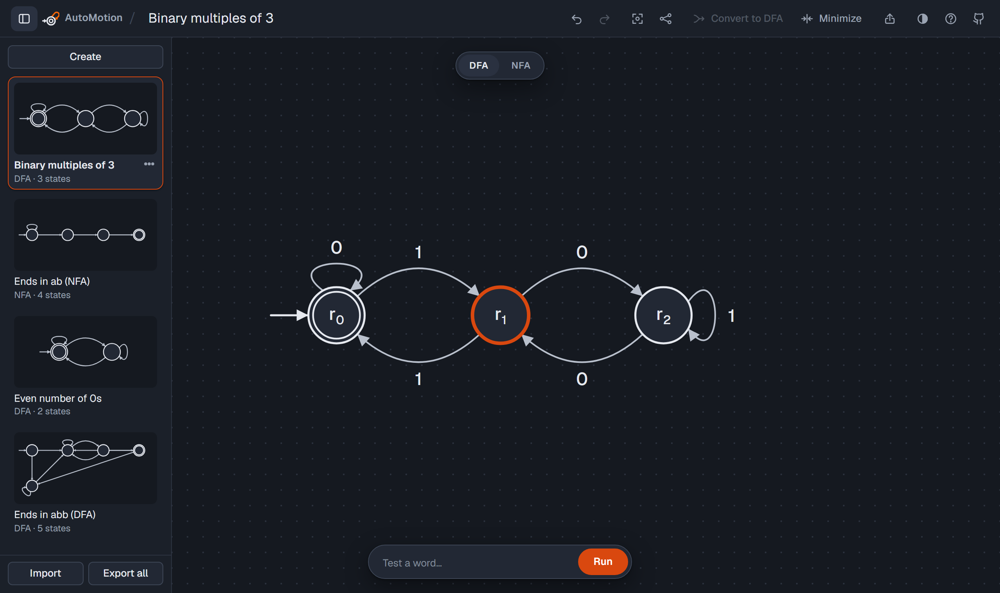

<p align="center">
  <a href="https://tomerti.github.io/automotion/">
    <picture>
      <source media="(prefers-color-scheme: dark)" srcset="docs/brand/lockup-dark.png">
      
    </picture>
  </a>
</p>

<p align="center">
  Build finite automata (DFAs and NFAs), draw them, and watch them run, step by step.<br>
  <a href="https://tomerti.github.io/automotion/"><b>Open the app →</b></a>
</p>


## Features

### Learn

- A first visit offers a two-minute interactive tutorial: build a DFA for an even number of 0s, run it, then change it to accept every word. A checklist in the corner ticks off each step as you do it, shows the next one, checks your automaton as you go and points at what to use. Restart it from the Controls popup (**?**).

### Build

- Double-click the canvas to add a state; Shift + drag from one state to another to add a transition (drop it on the same state for a self-loop).
- Double-click a state to rename it, or an arrow to edit its symbols. Labels like `q_1` and `q_{12}` show as subscripts, `\epsilon` types ε and, in a state name, `\emptyset` types ∅.
- Select a state and press **S** to toggle start, **A** to toggle accepting. An NFA can have several start states.
- Switch an automaton between DFA and NFA. Adding an ε-transition to a DFA makes it an NFA. DFAs may be partial: a missing transition rejects.
- The issues chip in the top bar explains what is wrong (no start state, two transitions on one symbol in a DFA, unreachable states, …), and actions that need a valid automaton say why they are disabled.
- Undo and redo (Ctrl+Z, Ctrl+Y) for each automaton.

### Arrange

- Drag states to move them; they snap into line with their neighbours (hold Alt to place freely).
- Ctrl + drag on the empty canvas selects the states in a box, and Ctrl + click adds a state to the selection or takes it out. Dragging a selected state moves the whole selection.
- **Ctrl+C** copies the selected states and **Ctrl+V** pastes them at the pointer, with the arrows between them and their arrows to the rest of the automaton: build a chain once, then repeat it. Pasted names get a prime (q₁ → q₁′). Pasting works in another automaton too.
- Drag an arrow to bend it, or a self-loop to turn it around its state.
- **Tidy** lays the whole automaton out automatically, and **Fit** brings it into view. Pan by dragging the canvas, zoom by scrolling.

### Run a word

- Type a word into **Test a word** and press Enter. The run plays at once on a tape with a read head, lighting up the active states and the transition just taken.
- Play, pause, step back and forth, scrub to any step and change the speed. NFA runs show each ε-closure as its own step and mark dead branches.
- The run ends in an **Accepted** or **Rejected** banner that says why. `ε` or an empty box tests the empty word.

### Convert and minimize


- **Convert to DFA** walks through the subset construction, with the NFA and the DFA being built side by side, one move and ε-closure per step. An NFA with several start states first gets a single new start state with ε-transitions to the old ones.
- **Minimize** walks through partition refinement (Moore's algorithm) for a DFA, and says so when it is already minimal.
- Save either result as a new automaton.

### Keep your work



- Everything autosaves in your browser. The history sidebar lists every automaton with a thumbnail, most recently edited first; rename, duplicate, export or delete one from its ⋯ menu.
- Import and export automata as JSON files, one or all at once, and export a diagram as SVG or PNG.
- Copy the diagram as a picture (**Ctrl+C**, or Copy image in the export menu) and paste it straight into a document or chat. Copied or downloaded, the picture is always the whole automaton at the same size, however far the canvas is zoomed or panned.
- Light and dark themes: it follows your system by default, or pick Light or Dark from the theme menu. Press **?** for the controls guide at any time.

## Development

```
npm install
npm run dev      # dev server at http://localhost:5173/automotion/
npm test         # unit and component tests (Vitest)
npm run e2e      # end-to-end tests (Playwright, Chromium; builds and serves the app)
npm run build    # type-check and production build into dist/
```

The first `npm run e2e` needs a browser: `npx playwright install chromium`.

Built with TypeScript, React, Vite, Zustand and elkjs, with a custom SVG renderer. CI runs typecheck, lint, unit and end-to-end tests on every push and pull request, and deploys `master` to GitHub Pages once they pass. See [PROGRESS.md](PROGRESS.md) for what is planned next, and [docs/brand](docs/brand) for the logo files.
